# Rowdy CyberCon 2026 CTF    

**Challenge Name:** One Diamond Short   

**Challenge Description:** I've been stuck playing the 15-minute Minecraft demo every day when I get home from school. 
I. AM. SICK. OF. IT. Today, they released an announcement where if you 
can get 10 diamonds in 15 minutes, they'll give 
you a free Minecraft code. I NEED THAT CODE! Give it to me.

**Challenge Category:** Reverse Engineering

**Challenge Difficulty:** Easy

# TL;DR

Based on the program description and by looking at the decompilation of the source code, I deduced that 
there must be a program variable that holds the number of diamonds in the player's inventory. Basically, the 
program logic works something like this: **If your diamond count is evaluated to 10, the conditions 
needed to win will evaluate to true, resulting in the flag being printed to both the game screen and the 
README**. I used Ghidra to locate these variables, conditions and map out general program logic. I also used Cheat 
Engine to find between 3 and 5 values that were actively keeping track of the diamond count as the game ran. With these 
values in mind, I then set the value 
at these addresses to 10 until the actual diamond count was changed, displaying the flag on the game screen.

# Tools Used
    - VMware Workstation
    - Kali Linux VM
    - Detect It Easy (DiE)
    - Ghidra    
    - Cheat Engine

# First Impressions/Theories
Before I started the challenge, I parsed everything in the game folder, this included the OneDiamondShort.exe, 
README.txt and the asset folders for anything of interest. No dice.

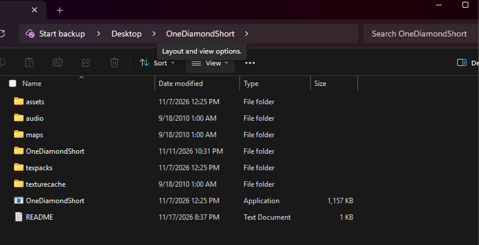

I then just ran the game just to see what the 
menu looked like, maybe something was hidden. While playing, I didn't find anything of interest. Just like the game 
description, there only seemed to be 9 diamond blocks. I did notice however the diamond counter at the top left 
of the screen, maybe something to keep note of. Ran the game till the timer ended and ... nothing happened, the game 
ended as expected. I did consider the idea that maybe there really was a 10th diamond block somewhere on the map, 
maybe it was just a matter of finding it. Maybe if I looked at the decompilation, I could find the coordinates of 
this block. Another thing I noticed was that there seemed to be no random world generation with the game, every time 
you loaded the game, everything (from what I could see) spawned in the same place every playthrough. After all of this,
I decided to get more info on the exe file so that I could start figuring out what tools would be compatible.
I opened my Kali Linux VM on VMware Workstation and passed my OneDiamondShort.exe file to Detect It Easy. I saw that the
file type was PE64 (Portable Executable for Windows 64-bit operating systems) 

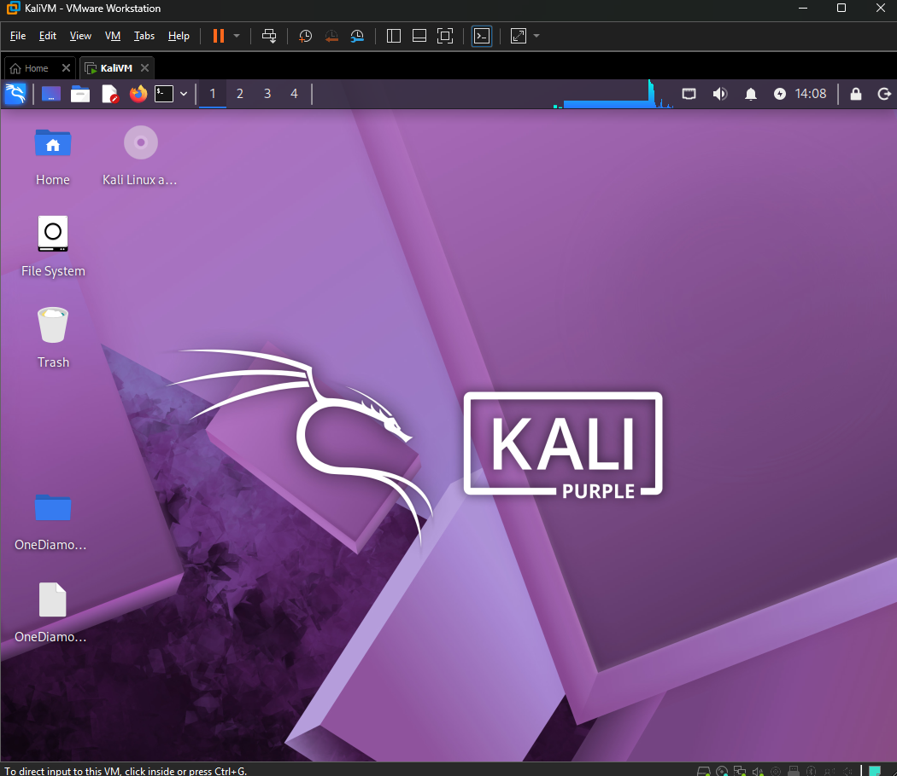

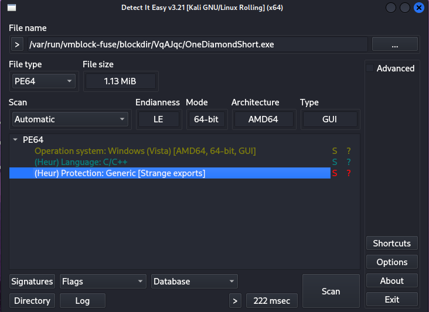

<details><summary>Disclaimer</summary>While most of these tools are cross-platform, x64dbg is only available 
on Windows and VMware Workstation Pro is only available on Windows and Linux. You don't have to use these specific 
tools, these are just the ones I decided to use. If you're on Mac or Linux (natively speaking), you will be unable to run 
this program as it is a 64-bit Windows Portable Executable (PE64). My team and I at Rowdy CyberCon found out the hard way
that I could only run the program as I was on Windows and my teammates were on Mac. I'm aware that
I didn't use the quickest or most efficient methods to approach this problem but that's not the goal of this write-up. 
My goal was to explain how I approached a problem like this for the first time, explain my thought process
and show the mistakes made along the way for future me and any reader who finds it useful.</details>


# Solution
With the exe being PE64, I decided to use Ghidra for static analysis and both x64dbg (debugger) and 
Cheat Engine (live memory manipulation) for dynamic analysis. While in my Kali Linux VM, I loaded Ghidra,

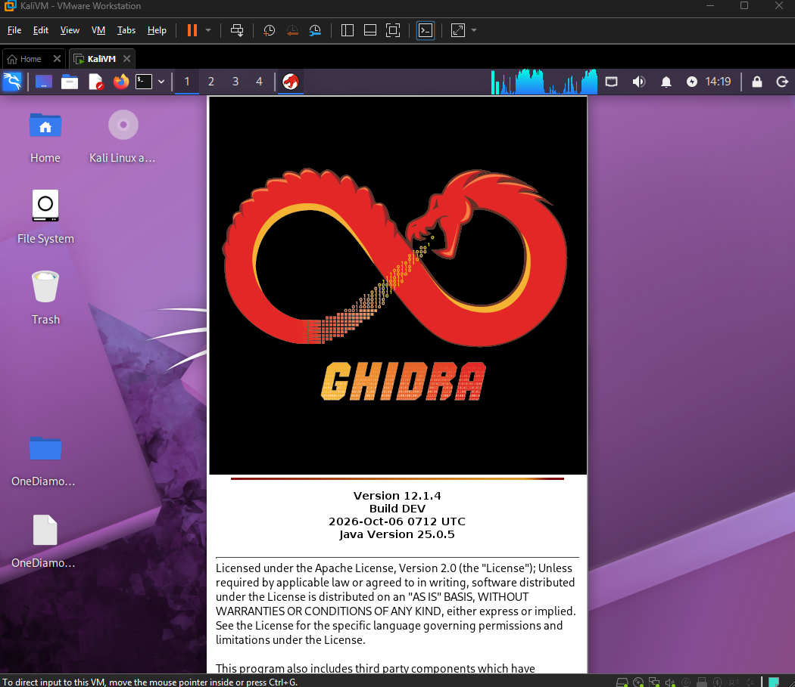

created a 
new project folder and dragged my OneDiamondShort.exe file from Windows into the project.
I opened the project in Code 
Browser and pressed yes to analyze the exe file. 

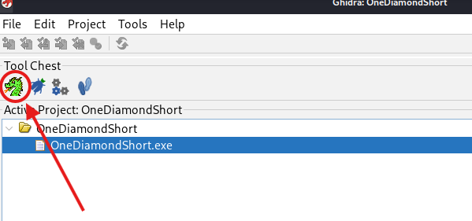


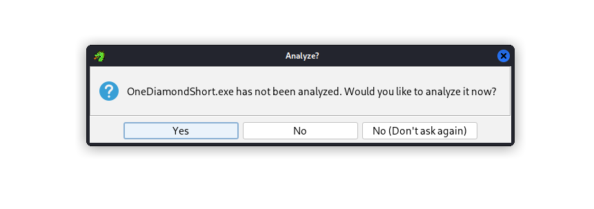

Once done decompiling, I was taken to the function labeled "entry" 
which is the entry point to our exe program, go figure. While here, I did a quick scan of the function list, found 
nothing. I then went to the toolbar at the top and pressed Search → For Strings → left the default options and
pressed Search.

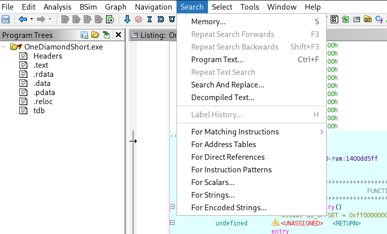

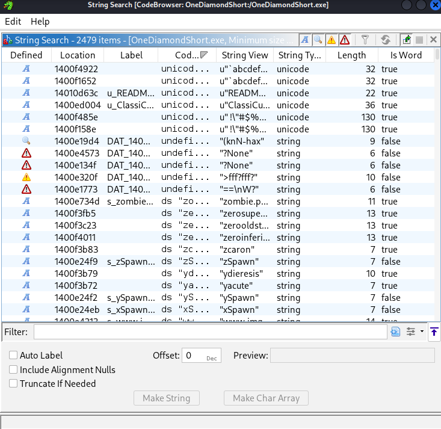

In the filter bar, I typed multiple strings that I thought could be of interest. These first strings 
included "Diamond", "Count", "RCC", "Win", and "Flag". 

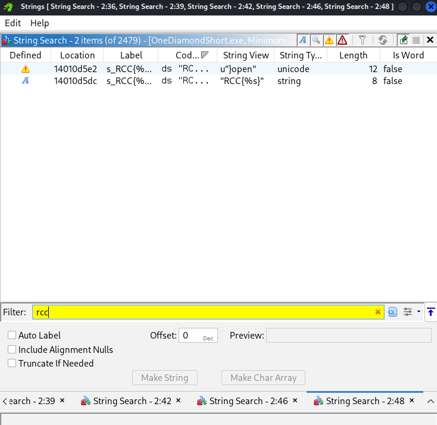

<details><summary>Why these strings?</summary>I did a string search of these 5 phrases which would bring up all the
instances that they show up in the program. With "Diamond", I wanted to see which statements and functions used that word
which could give me a better layout of the program by showing me all the printf statements that could be executed based
on which conditions were met, including their addresses. The diamond count display in the game was what set this
idea off as well. I know that whatever statement or function is in charge of printing out the diamond count must be reading 
from the actual diamond count value to update what is printed to the screen. If I could find that statement/function
maybe I could trace it to the actual diamond count variable, get its address, go into a memory manipulator and
change the value at that address. "Count" was in the same vein as "Diamond" but didn't lead me anywhere. "RCC" because
the flag format for most of the CTF problems was "RCC{}". What's interesting about this search is that it didn't lead me
to the diamond count but actually led me to the function and portion of the code that was in charge of printing
the flag to the game screen and the README once the win condition was met. If the flag was hardcoded in the program,
it very likely would have been here. "Win" and "Flag" were the same idea as the last string as I hoped they
could bring me closer to understanding how the logic of the win condition worked but nothing came from them.
</details>


Through this, I found the instances in the decompiled functions 
where these words were printed. Through this process, I located the addresses of the function that held the end 
message displays, the function that included the win conditions and the format for the flag printout. As I suspected,
the actual flag was not hardcoded into the program, if that were the case, I probably wouldn't have needed to go 
through the process of dynamic analysis. The statement that printed the flag looked like this:

```c
FUN_1400dd1d0((longlong)param_1 + 0x21,0x16,"RCC{%s}",param_1 + 4);
```
We can see two of the arguments towards the end of this printf statement are the string literal and the %s 
format specifier. With this, I considered the idea that if I could just locate the address stored by the pointer, I could 
maybe find the flag value. I was unable to do so but in looking at this function, I found this interesting if 
condition:
```c
if (param_2[10] == 10)
```

Looking at this condition, it seemed rather specific. We are checking for equality between an array element and 10.
Could this element in the array be in charge of our diamond count in game? Matter of fact, the previous printf 
statement I just listed lies within this if statement. Here's what I determined from this, this element must be the 
value in charge of the diamond count. If I could somehow locate the memory address of this array and element at index
10, I could maybe open Cheat Engine, locate that same address and change that value to 10 as the game was running. 
With these 
addresses and the array element 10 in mind, I had a better idea of what I needed to manipulate in order to 
pass the win condition. This is where I moved back to my Windows machine, ran the exe and started doing dynamic analysis 
and 
manipulation with 
Cheat Engine.

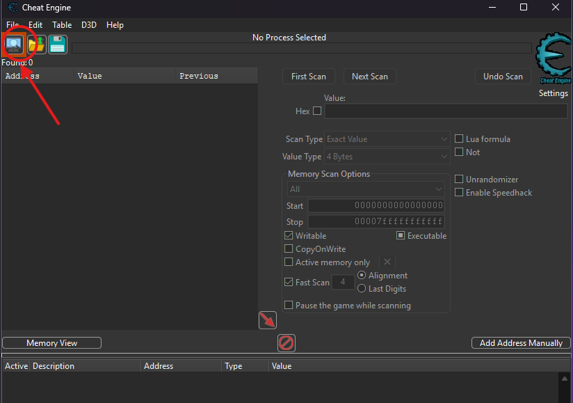

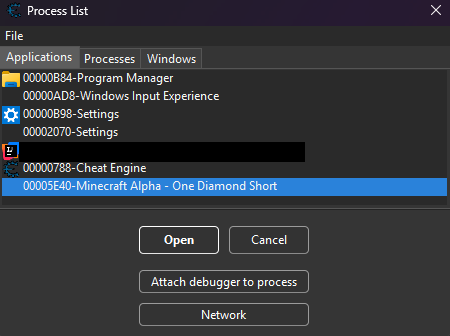

Here is my logic, I know that we have an array element somewhere in memory that is getting checked for 
equality with the value 10. Because of this, I believe that 10 is possibly being stored as an integer. Because
arrays can only store elements of the same type as the array, the array must be an integer array, meaning 
that each element in the array is 4 bytes. 


While the game is running, I mine and get
three diamonds, I then run a 
scan for 4 byte values that hold the int 3.

<details><summary>Why matches for 4 bytes aren't 100% foolproof</summary>

Just because I did a scan for 4 bytes, doesn’t mean that specific memory 
address holds a value of a variable that was declared as an int. It might be entirely possible that the value at 
that memory address when read as 4 bytes just happens to be the same value I'm looking for, that is why we do 
multiple scans which narrow down the potential results.</details>


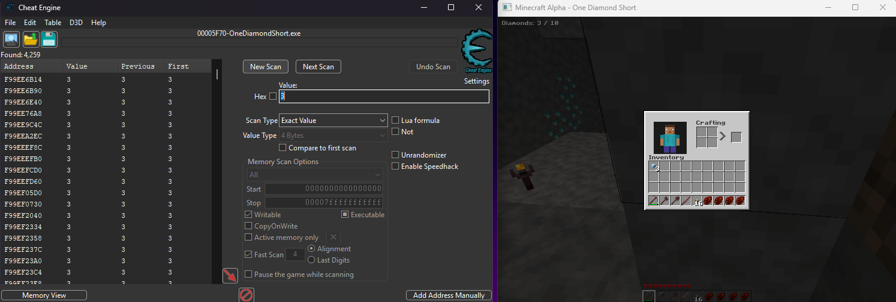

*Scan for 3*


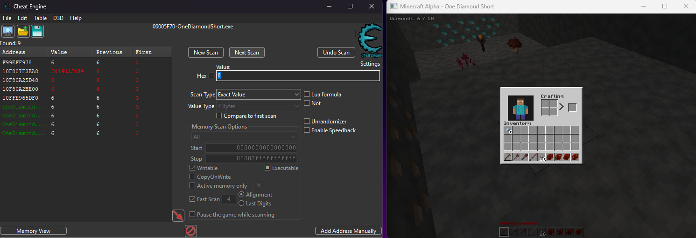

*Scan for 6*

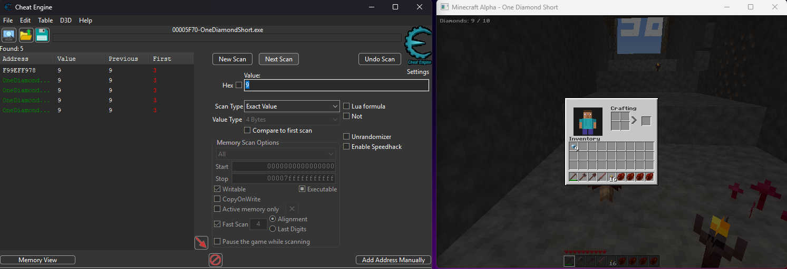

*Scan for 9*

Once you have the list of addresses narrowed down, go ahead and
double-click each address in the found section. This will cause the addresses to appear in the tab at the bottom with 
check boxes appearing to the left of each new entry. We will now go through each address one by one and double-click
on the value for the address under the value column. A pop-up comes up that asks, "What value to change this to?". 
Just enter the value "10", and press "OK". 

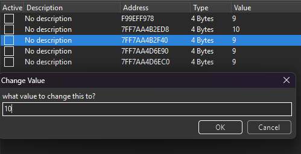

In my walkthrough, I decided not to freeze the values in the active column. In my case, I didn't need to but just know that 
freezing the values is another step you can take if you want to ensure the value is picked up by the win check.

<details><summary>Why would I freeze these values and how do I do that?</summary>

We freeze the address because the game is continuously checking and rewriting the value each frame. You can see
this if you set the value to 10 without freezing first. In some cases, it immediately snaps back to the real count before 
being able to be read. Freezing
holds it at 10 long enough for the win condition to read it.

With that being said, freezing isn't always 100% necessary. This is because sometimes setting the value once is enough 
if the win check happens to read your value before the game resets it. Because of this, I would recommend 
freezing as it will ensure that the new value remains long enough to be checked.

To freeze the values, you want to double-click on the checkbox to
the far left of the address. There should now be either an x or a checkmark in the checkbox.</details>

Now look at the running exe file, there are two potential outcomes that could happen once you've changed the value. Either (a) you changed the 
value to 10, you check the running game and see the flag is printed to the game screen, or (b) nothing happens. If it's
(a), congratulations, you've officially found the flag!

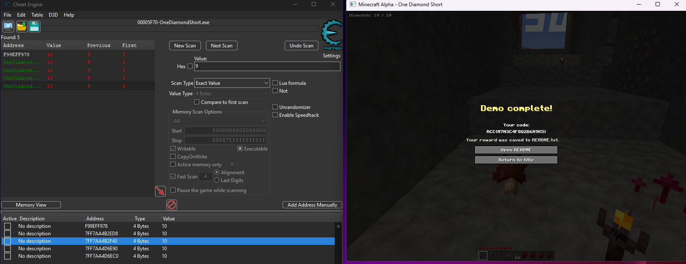

*With the diamond count being 10, the win condition is satisfied and the flag is printed*

If it's (b), then you need to move to the next address and 
continue the process mentioned earlier. If you do this for each address and are not shown the flag, then you're 
going to have to close Cheat Engine and the exe program entirely, then complete the beginning process with Cheat
Engine once again until the flag is printed to the game screen.


# Dead Ends/Lessons
**These are all the problems I ran into and things I learned during the process of trying to get the flag.**

Manipulating the diamond count printed to the screen. Would immediately snap back to the **Actual** diamond count.
<details><summary>Explanation</summary>

I think this is what led me to believe that I couldn't change the actual diamond count value which led me to 
look for alternative methods to get the flag. I tried doing the Cheat Engine 4-byte value changes to 10 like I did 
for the solution but ended up just changing the value that got printed to the screen. This was before I knew about the
freeze feature so the value wouldn't even stay as 10, it would switch back to the actual value immediately. However, 
this gave me more insight into when the value of the diamond was checked which was during every frame.
</details>

Using NOP with write instructions.
<details><summary>Explanation</summary>

Because I didn't know the freeze feature, I decided to NOP (No Operation) the write instructions of the values that I 
scanned for in Cheat Engine. This ended up breaking parts of the game and ended up confusing me even more. I'm not
saying it couldn't be useful in this case, I just wasn't sure how to use it or apply it properly.
</details>

Flipping too many ZF values of multiple conditions when I only needed to flip the ZF value one condition.
<details><summary>Explanation</summary>

This is part of my original solution to this CTF which is not a part of the write-up. For my original solution, I 
ended up attempting to bypass the win conditions by using control flow manipulation by flipping the ZF flags after
specific TEST (Bitwise Test) and CMP (Compare) instructions that would affect the following jump that JE (Jump If Equal)
and JNE (Jump if Not Equal) would take. To even attempt this I had to learn more about registers and flags along with 
what the instructions of the disassembly even meant. I was able to do this by finding potential win-condition-related 
if statements statically with Ghidra and getting the addresses of these statements and looking at them 
dynamically with x64dbg. I opened the exe, set breakpoints at these addresses, ran the program until the breakpoints were hit, 
stepped over the TEST and CMP instructions and flipped the ZF flags live which would allow me to take the path I wanted toward 
the win. While it did work, there are easier solutions. I found out later on that changing the diamond count in 
memory was possible and a simpler solution.
</details>

Not extracting game assets along with the exe and the readme (unrendered assets).

<details><summary>Explanation</summary>

This one was just me thinking there was something wrong with the game at first when it was on me because I forgot to
extract everything from the given zipped folder. The actual exe depended on these folders to load the assets so without 
them, there were no assets, no text, nothing. It isn't that big of a mistake but when you're working with limited time
on a CTF, you want to put your time towards actually progressing and not fixing mistakes.
</details>


# FLAG
<details><summary>Press to view the flag</summary>RCC{M7N3C4F8Q2D6R9K5}</details>

The end ... FOR NOW
